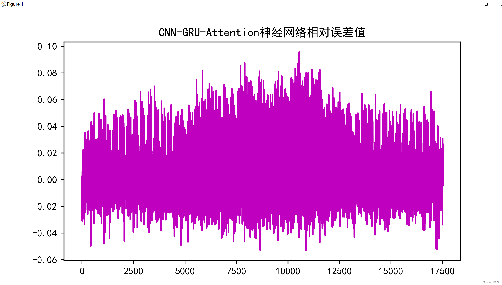
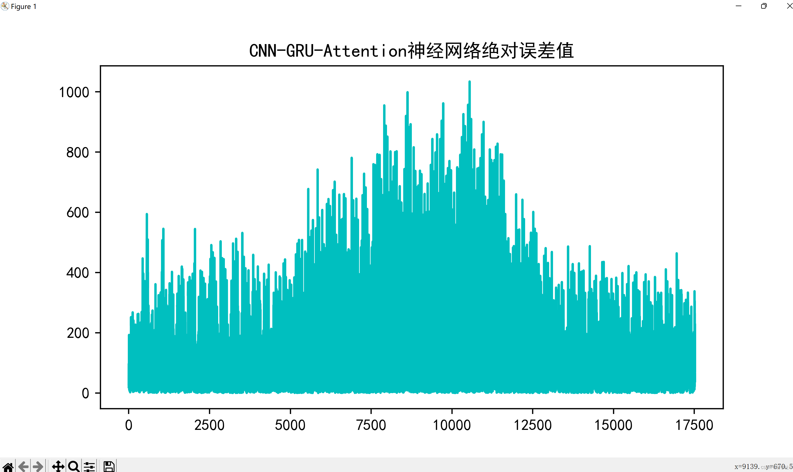
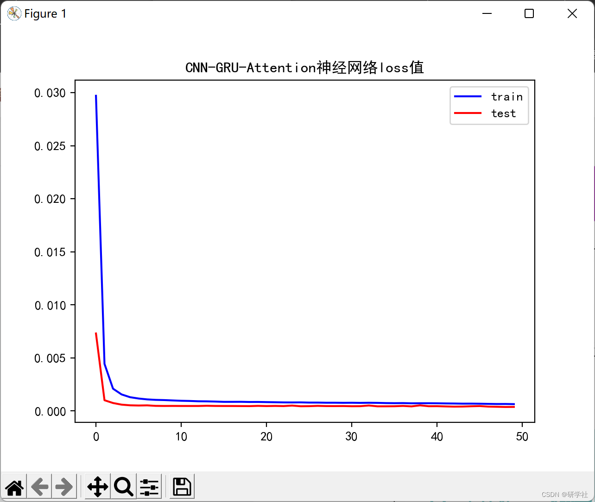
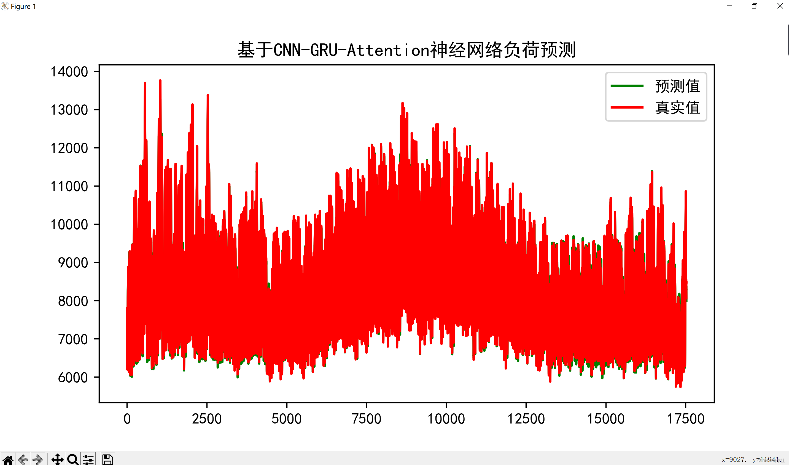
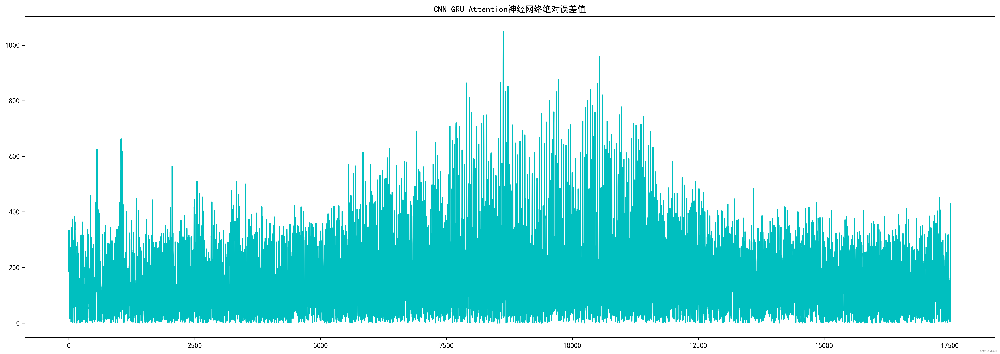
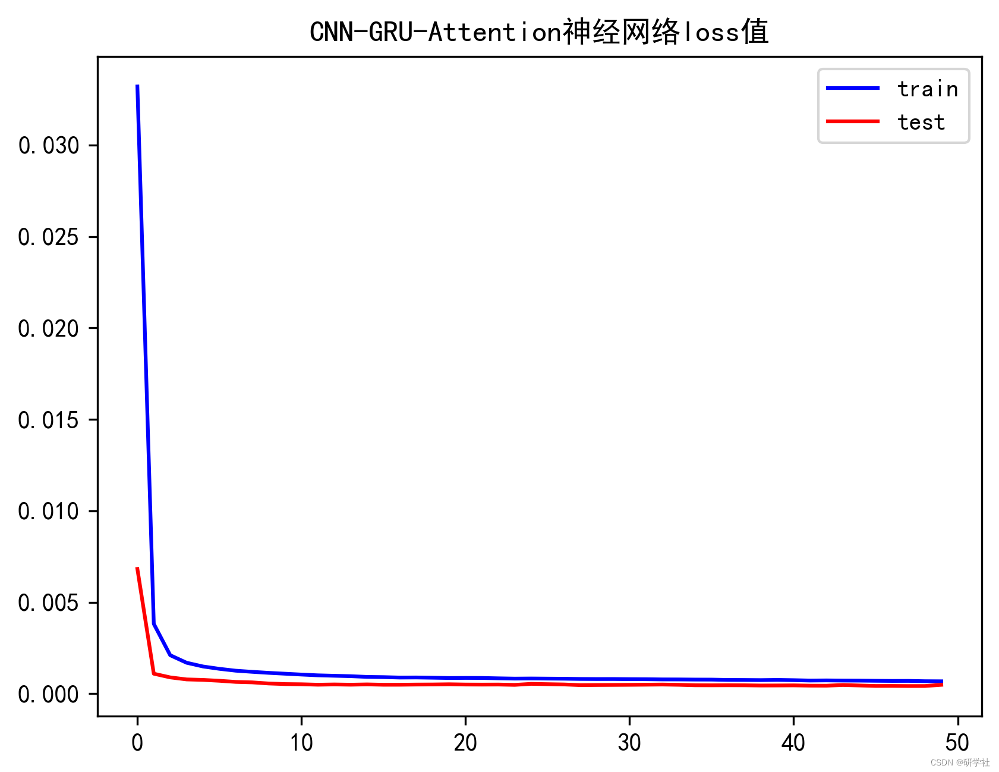
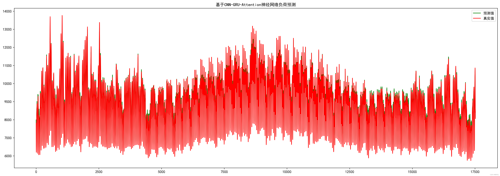

# Load Forecasting Method Based on CNN-GRU-Attention Mixed Neural Network (Python Code Implementation)

​  
📚2 Running Results Editing
Editor
Editor
Editor
Editor
Editor
To enable them in other operations, rebuild TensorFlow with the appropriate compiler flags.  
Model: "sequential"  
_________________________________________________________________  
Layer (type)        Output Shape       Param #  
=================================================================  
reshape (Reshape)     (None, 1, 7, 1)     0  
conv2d (Conv2D)      (None, 1, 7, 32)     320  
max_pooling2d (MaxPooling2D (None, 1, 7, 32)    0  
)  
dropout (Dropout)     (None, 1, 7, 32)     0  
reshape_1 (Reshape)    (None, 1, 224)      0  
gru (GRU)         (None, 1, 10)      7080  
gru_1 (GRU)        (None, 1, 20)      1920  
attention (Attention)   (None, 50)        2400  
dense (Dense)       (None, 10)        510  
dense_1 (Dense)      (None, 1)        11  
=================================================================  
Total params: 12,241  
Trainable params: 12,241  
Non-trainable params: 0  
_________________________________________________________________  
None  
Epoch 1/50  
2022-11-15 20:40:42.293543: W tensorflow/core/grappler/costs/op_level_cost_estimator.cc:690] Error in PredictCost() for the op: op: "Softmax" attr { key: "T" value { type: DT_FLOAT } } inputs { dtype: DT_FLOAT shape { unknown_rank: true } } device { type: "CPU" vendor: "AuthenticAMD" model: "240" frequency: 3194 num_cores: 16 environment { key: "cpu_instruction_set" value: "SSE, SSE2" } environment { key: "eigen" value: "3.4.90" } l1_cache_size: 32768 l2_cache_size: 524288 l3_cache_size: 16777216 memory_size: 268435456 } outputs { dtype: DT_FLOAT shape { unknown_rank: true } }  
2022-11-15 20:40:43.604200: W tensorflow/core/grappler/costs/op_level_cost_estimator.cc:690] Error in PredictCost() for the op: op: "Softmax" attr { key: "T" value { type: DT_FLOAT } } inputs { dtype: DT_FLOAT shape { unknown_rank: true } } device { type: "CPU" vendor: "AuthenticAMD" model: "240" frequency: 3194 num_cores: 16 environment { key: "cpu_instruction_set" value: "SSE, SSE2" } environment { key: "eigen" value: "3.4.90" } l1_cache_size: 32768 l2_cache_size: 524288 l3_cache_size: 16777216 memory_size: 268435456 } outputs { dtype: DT_FLOAT shape { unknown_rank: true } }  
103/103 - 3s - loss: 0.0332 - mse: 0.0332 - val_loss: 0.0068 - val_mse: 0.0068 - 3s/epoch - 29ms/step  
Epoch 2/50  
103/103 - 0s - loss: 0.0038 - mse: 0.0038 - val_loss: 0.0011 - val_mse: 0.0011 - 380ms/epoch - 4ms/step  
Epoch 3/50  
103/103 - 0s - loss: 0.0021 - mse: 0.0021 - val_loss: 8.9063e-04 - val_mse: 8.9063e-04 - 380ms/epoch - 4ms/step  
Epoch 4/50  
103/103 - 0s - loss: 0.0017 - mse: 0.0017 - val_loss: 7.7933e-04 - val_mse: 7.7933e-04 - 390ms/epoch - 4ms/step  
Epoch 5/50  
103/103 - 0s - loss: 0.0015 - mse: 0.0015 - val_loss: 7.5322e-04 - val_mse: 7.5322e-04 - 380ms/epoch - 4ms/step  
Epoch 6/50  
103/103 - 0s - loss: 0.0014 - mse: 0.0014 - val_loss: 7.0502e-04 - val_mse: 7.0502e-04 - 370ms/epoch - 4ms/step  
Epoch 7/50  
103/103 - 0s - loss: 0.0013 - mse: 0.0013 - val_loss: 6.4338e-04 - val_mse: 6.4338e-04 - 380ms/epoch - 4ms/step  
Epoch 8/50  
103/103 - 0s - loss: 0.0012 - mse: 0.0012 - val_loss: 6.1803e-04 - val_mse: 6.1803e-04 - 370ms/epoch - 4ms/step  
Epoch 9/50  
103/103 - 0s - loss: 0.0011 - mse: 0.0011 - val_loss: 5.5700e-04 - val_mse: 5.5700e-04 - 380ms/epoch - 4ms/step  
Epoch 10/50  
103/103 - 0s - loss: 0.0011 - mse: 0.0011 - val_loss: 5.2479e-04 - val_mse: 5.2479e-04 - 370ms/epoch - 4ms/step  
Epoch 11/50  
103/103 - 0s - loss: 0.0010 - mse: 0.0010 - val_loss: 5.1472e-04 - val_mse: 5.1472e-04 - 407ms/epoch - 4ms/step  
Epoch 12/50  
103/103 - 0s - loss: 0.0010 - mse: 0.0010 - val_loss: 4.8988e-04 - val_mse: 4.8988e-04 - 404ms/epoch - 4ms/step  
Epoch 13/50  
103/103 - 0s - loss: 9.7950e-04 - mse: 9.7950e-04 - val_loss: 5.0468e-04 - val_mse: 5.0468e-04 - 390ms/epoch - 4ms/step  
Epoch 14/50  
103/103 - 0s - loss: 9.5678e-04 - mse: 9.5678e-04 - val_loss: 4.9064e-04 - val_mse: 4.9064e-04 - 448ms/epoch - 4ms/step  
Epoch 15/50  
103/103 - 0s - loss: 9.1728e-04 - mse: 9.1728e-04 - val_loss: 5.0738e-04 - val_mse: 5.0738e-04 - 374ms/epoch - 4ms/step  
Epoch 16/50  
103/103 - 0s - loss: 9.0497e-04 - mse: 9.0497e-04 - val_loss: 4.8773e-04 - val_mse: 4.8773e-04 - 386ms/epoch - 4ms/step  
Epoch 17/50  
103/103 - 0s - loss: 8.8163e-04 - mse: 8.8163e-04 - val_loss: 4.8866e-04 - val_mse: 4.8866e-04 - 391ms/epoch - 4ms/step  
Epoch 18/50  
103/103 - 0s - loss: 8.8587e-04 - mse: 8.8587e-04 - val_loss: 4.9860e-04 - val_mse: 4.9860e-04 - 378ms/epoch - 4ms/step  
Epoch 19/50  
103/103 - 0s - loss: 8.7227e-04 - mse: 8.7227e-04 - val_loss: 5.0278e-04 - val_mse: 5.0278e-04 - 417ms/epoch - 4ms/step  
Epoch 20/50  
103/103 - 0s - loss: 8.5672e-04 - mse: 8.5672e-04 - val_loss: 5.1483e-04 - val_mse: 5.1483e-04 - 427ms/epoch - 4ms/step  
Epoch 21/50  
103/103 - 0s - loss: 8.6189e-04 - mse: 8.6189e-04 - val_loss: 4.9968e-04 - val_mse: 4.9968e-04 - 380ms/epoch - 4ms/step  
Epoch 22/50  
103/103 - 0s - loss: 8.5941e-04 - mse: 8.5941e-04 - val_loss: 4.9605e-04 - val_mse: 4.9605e-04 - 375ms/epoch - 4ms/step  
Epoch 23/50  
103/103 - 0s - loss: 8.3976e-04 - mse: 8.3976e-04 - val_loss: 4.9938e-04 - val_mse: 4.9938e-04 - 372ms/epoch - 4ms/step  
Epoch 24/50  
103/103 - 0s - loss: 8.2392e-04 - mse: 8.2392e-04 - val_loss: 4.8102e-04 - val_mse: 4.8102e-04 - 380ms/epoch - 4ms/step  
Epoch 25/50  
103/103 - 0s - loss: 8.3040e-04 - mse: 8.3040e-04 - val_loss: 5.3633e-04 - val_mse: 5.3633e-04 - 376ms/epoch - 4ms/step  
Epoch 26/50  
103/103 - 0s - loss: 8.2367e-04 - mse: 8.2367e-04 - val_loss: 5.1988e-04 - val_mse: 5.1988e-04 - 381ms/epoch - 4ms/step  
Epoch 27/50  
103/103 - 0s - loss: 8.1775e-04 - mse: 8.1775e-04 - val_loss: 5.0360e-04 - val_mse: 5.0360e-04 - 375ms/epoch - 4ms/step  
Epoch 28/50  
103/103 - 0s - loss: 8.0505e-04 - mse: 8.0505e-04 - val_loss: 4.6806e-04 - val_mse: 4.6806e-04 - 373ms/epoch - 4ms/step  
Epoch 29/50  
103/103 - 0s - loss: 8.0057e-04 - mse: 8.0057e-04 - val_loss: 4.7476e-04 - val_mse: 4.7476e-04 - 369ms/epoch - 4ms/step  
Epoch 30/50  
103/103 - 0s - loss: 8.0176e-04 - mse: 8.0176e-04 - val_loss: 4.7907e-04 - val_mse: 4.7907e-04 - 370ms/epoch - 4ms/step  
Epoch 31/50  
103/103 - 0s - loss: 7.9466e-04 - mse: 7.9466e-04 - val_loss: 4.8413e-04 - val_mse: 4.8413e-04 - 380ms/epoch - 4ms/step  
Epoch 32/50  
103/103 - 0s - loss: 7.9054e-04 - mse: 7.9054e-04 - val_loss: 4.9138e-04 - val_mse: 4.9138e-04 - 376ms/epoch - 4ms/step  
Epoch 33/50  
103/103 - 0s - loss: 7.8007e-04 - mse: 7.8007e-04 - val_loss: 4.9920e-04 - val_mse: 4.9920e-04 - 376ms/epoch - 4ms/step  
Epoch 34/50  
103/103 - 0s - loss: 7.7809e-04 - mse: 7.7809e-04 - val_loss: 4.8480e-04 - val_mse: 4.8480e-04 - 380ms/epoch - 4ms/step  
Epoch 35/50  
103/103 - 0s - loss: 7.7086e-04 - mse: 7.7086e-04 - val_loss: 4.6018e-04 - val_mse: 4.6018e-04 - 389ms/epoch - 4ms/step  
Epoch 36/50  
103/103 - 0s - loss: 7.6884e-04 - mse: 7.6884e-04 - val_loss: 4.5810e-04 - val_mse: 4.5810e-04 - 374ms/epoch - 4ms/step  
Epoch 37/50  
103/103 - 0s - loss: 7.5240e-04 - mse: 7.5240e-04 - val_loss: 4.6063e-04 - val_mse: 4.6063e-04 - 381ms/epoch - 4ms/step  
Epoch 38/50  
103/103 - 0s - loss: 7.4910e-04 - mse: 7.4910e-04 - val_loss: 4.5822e-04 - val_mse: 4.5822e-04 - 368ms/epoch - 4ms/step  
Epoch 39/50  
103/103 - 0s - loss: 7.4235e-04 - mse: 7.4235e-04 - val_loss: 4.4666e-04 - val_mse: 4.4666e-04 - 385ms/epoch - 4ms/step  
Epoch 40/50  
103/103 - 0s - loss: 7.5361e-04 - mse: 7.5361e-04 - val_loss: 4.4947e-04 - val_mse: 4.4947e-04 - 371ms/epoch - 4ms/step  
Epoch 41/50  
103/103 - 0s - loss: 7.3891e-04 - mse: 7.3891e-04 - val_loss: 4.5411e-04 - val_mse: 4.5411e-04 - 380ms/epoch - 4ms/step  
Epoch 42/50  
103/103 - 0s - loss: 7.1854e-04 - mse: 7.1854e-04 - val_loss: 4.3896e-04 - val_mse: 4.3896e-04 - 379ms/epoch - 4ms/step  
Epoch 43/50  
103/103 - 0s - loss: 7.2564e-04 - mse: 7.2564e-04 - val_loss: 4.3702e-04 - val_mse: 4.3702e-04 - 378ms/epoch - 4ms/step  
Epoch 44/50  
103/103 - 0s - loss: 7.1769e-04 - mse: 7.1769e-04 - val_loss: 4.7473e-04 - val_mse: 4.7473e-04 - 382ms/epoch - 4ms/step  
Epoch 45/50  
103/103 - 0s - loss: 7.1356e-04 - mse: 7.1356e-04 - val_loss: 4.4865e-04 - val_mse: 4.4865e-04 - 378ms/epoch - 4ms/step  
Epoch 46/50  
103/103 - 0s - loss: 7.0446e-04 - mse: 7.0446e-04 - val_loss: 4.2275e-04 - val_mse: 4.2275e-04 - 384ms/epoch - 4ms/step  
Epoch 47/50  
103/103 - 0s - loss: 6.9736e-04 - mse: 6.9736e-04 - val_loss: 4.2445e-04 - val_mse: 4.2445e-04 - 380ms/epoch - 4ms/step  
Epoch 48/50  
103/103 - 0s - loss: 6.9928e-04 - mse: 6.9928e-04 - val_loss: 4.1869e-04 - val_mse: 4.1869e-04 - 374ms/epoch - 4ms/step  
Epoch 49/50  
103/103 - 0s - loss: 6.8223e-04 - mse: 6.8223e-04 - val_loss: 4.1971e-04 - val_mse: 4.1971e-04 - 370ms/epoch - 4ms/step  
Epoch 50/50  
103/103 - 0s - loss: 6.7743e-04 - mse: 6.7743e-04 - val_loss: 4.8369e-04 - val_mse: 4.8369e-04 - 383ms/epoch - 4ms/step  
2022-11-15 20:41:02.847965: W tensorflow/core/grappler/costs/op_level_cost_estimator.cc:690] Error in PredictCost() for the op: op: "Softmax" attr { key: "T" value { type: DT_FLOAT } } inputs { dtype: DT_FLOAT shape { unknown_rank: true } } device { type: "CPU" vendor: "AuthenticAMD" model: "240" frequency: 3194 num_cores: 16 environment { key: "cpu_instruction_set" value: "SSE, SSE2" } environment { key: "eigen" value: "3.4.90" } l1_cache_size: 32768 l2_cache_size: 524288 l3_cache_size: 16777216 memory_size: 268435456 } outputs { dtype: DT_FLOAT shape { unknown_rank: true } }  
Test RMSE: 189.232  
Test MAPE: 1.764  
Test R2: 0.981  
Test MAE: 152.840  
Process finished with exit code 0  
🎉4 References
[2] Yao Chengwen, Yang Ping, Liu Zejian. A Load Forecasting Method Based on CNN-GRU Mixed Neural Network [J]. Power Grid Technology, 2020, 44(9):3416-3423  
[3] Gao Ao, Li Guoyu, Zhang Aoyang, Zhou Shengqi, Wei Zhen, Zhang Zhisheng. Short-term Load Forecasting Model Based on Adam Algorithm Optimized GRU Neural Network [J]. Electronic Design Engineering, 2022, 30(09):180-183+188. DOI:10.14022/j.issn1674-6236.2022.09.038.  
[4] Yao Chengwen, Yang Ping, Liu Zejian. A Load Forecasting Method Based on CNN-GRU Mixed Neural Network [J]. Power Grid Technology, 2020, 44(09):3416-3424. DOI:10.13335/j.1000-3673.pst.2019.2058.

## Images

<!-- PAYMENT_BLOCK -->

## Get this dataset

- Payment link (Stripe): [Buy now](https://buy.stripe.com/3cs8yP7sY87d0vu9AB)
- Payment QR code: 

<!-- /PAYMENT_BLOCK -->
